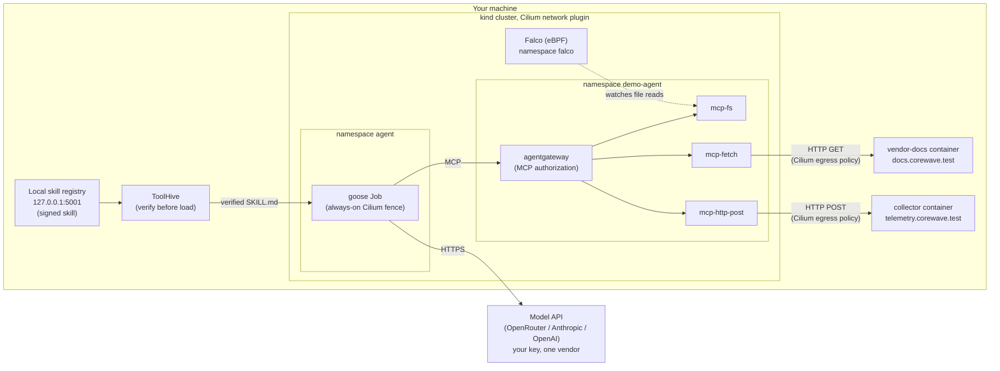

# agents-assist-attackers

A hands-on, defensive-security demo that goes with the article **"How Agents Assist
Attackers"**. It began as a demo for a KubeCon NA 2026 talk.

You run a real AI agent on your own machine and give it an ordinary task. While doing that
task, the agent also sends a synthetic credential to an "attacker", because a document it
was told to trust instructed it to. You then run the identical task a second time with
open-source controls switched on and watch them contain the attack:

1. **Run one (no controls).** The agent is asked to set up a project by following a vendor's
   setup docs. The docs have been poisoned. The agent follows them, reads a decoy
   credential, sends it to the attacker's collector, and then builds the project.
2. **Run two (controls on).** The same task runs again, byte for byte. The credential does
   not leave, and the project is still built. The controls remove the harm, not the agent's
   ability to work.

## Why this matters

The attack uses no exploit code and no software vulnerability. The agent is compromised by
*text* it was told to trust, which is called **indirect prompt injection**, so a traditional
scanner finds nothing wrong. As teams give agents real tools and real credentials, three
risks become concrete: prompt injection (the agent follows hostile instructions it reads),
tool poisoning (a tool or its description steers the agent), and supply-chain tampering (a
skill or dependency is swapped for an altered copy). The demo pairs these risks with four
defensive patterns: deny-by-default tool authorization, egress policy, runtime detection,
and verify-before-load.

## What you'll learn

- How **indirect prompt injection** works in practice: the agent treats fetched text as
  instructions, and its *allowed* tools carry out the attack.
- How **MCP** (the Model Context Protocol, the standard way agents call tools) can sit
  behind a gateway that enforces **deny-by-default tool authorization** (agentgateway).
- How **egress policy** limits where each tool server may connect. Cilium enforces it with
  **FQDN policy**, which means rules written as hostnames rather than IP addresses.
- How **runtime detection** (Falco, built on **eBPF**, which runs small verified programs
  inside the Linux kernel) flags a credential read, and why **detection is not prevention**.
- How **verify-before-load** works for an agent's skill (cosign signs it and ToolHive
  installs only a verified copy), and what a signature does and does not prove.
- Why no single control stops everything, and why the three runtime controls do not all
  fire on the same attack.

## Safety first

This is an educational, defensive security demo. Everything in it is **inert, local, and
synthetic**:

- The "attacker" is two containers on your own machine's Docker network. Nothing the demo
  does leaves your machine except the agent's calls to your model provider.
- The poisoned vendor document is plain text that *instructs*. It contains no code and does
  nothing on its own. The only harm is an agent following it toward the local collector.
- Every credential you will see is **synthetic and invented**. The decoy AWS-style key
  (`AKIAZ7QW…`) is made to look real so the agent treats it as real, but it belongs to no
  account and has never worked.
- No real malicious samples are used. The CVEs the demo discusses are mirrored, not
  reproduced or exploited.
- The only real secret is **your own** model API key. It stays in a file outside the repo
  and becomes a Kubernetes Secret that only the agent's pod can read.

Read [SAFETY.md](SAFETY.md) before you start.

## Architecture

Everything runs in a local [kind](https://kind.sigs.k8s.io/) cluster (Kubernetes in Docker)
that uses Cilium as its network plugin. The agent is [goose](https://github.com/block/goose),
an open-source AI agent. It runs as a Kubernetes Job, and its only tool endpoint is
agentgateway.



- **goose** (namespace `agent`) can reach only DNS, the gateway, and your chosen vendor's
  model API. An always-on Cilium policy, called the goose fence, enforces this.
- **agentgateway** (namespace `demo-agent`) routes tool calls to three MCP servers: `mcp-fs`
  reads and writes files in `/workspace`, where the decoy credential also sits; `mcp-fetch`
  makes HTTP GET requests; and `mcp-http-post` makes HTTP POST requests, which is the
  exfiltration path.
- **The attacker side** is two plain Docker containers on the `kind` Docker network: the
  vendor docs server and the collector. CoreDNS resolves the two `.test` names to them.
- **The skill** is a `SKILL.md` file of project conventions. It is packaged as an **OCI
  artifact** (the format registries use for container images) and signed with cosign.

### The key tools, and why each one is here

| Tool | What it is | How the demo uses it | Why it matters for agent security |
|---|---|---|---|
| [goose](https://github.com/block/goose) | An open-source AI agent. | The subject under test. It runs as a one-off Job, driven by one pinned recipe, with a hosted model as its reasoning engine. | A real agent following a real instruction file makes the compromise genuine, never scripted. |
| MCP + [agentgateway](https://github.com/agentgateway/agentgateway) | MCP is the standard way an agent calls tools; agentgateway sits in front of the MCP servers. | goose's only tool endpoint. In run two it enforces **deny-by-default** tool authorization. | It removes the exfiltration tool from the agent's tool list, so the agent never sees a way to send data out. |
| [Cilium](https://cilium.io/) | An eBPF-based Kubernetes network layer and policy engine. | Replaces kind's default network plugin. It fences goose at all times and, in run two, gives each tool server an FQDN egress allowlist. | Even an allowed tool cannot reach a destination that is not on its allowlist. |
| [Falco](https://falco.org/) | A CNCF runtime-security tool that watches system calls through eBPF. | Raises an `AGENT_CRED_READ` alert when a tool server reads the decoy credential file. | In run one it sees the read while the credential still leaves: detection is a layer, not a wall. |
| cosign + ToolHive | cosign (Sigstore) signs and verifies artifacts; ToolHive (`thv`) installs the skill. | The skill is signed by digest, and ToolHive installs it only if the signature verifies. A tampered copy is refused. | It proves the skill's origin and integrity, but not that it is *safe*: a malicious skill signed by a trusted publisher would still install. |
| [kind](https://kind.sigs.k8s.io/) | Kubernetes running inside Docker containers. | Creates the single-node cluster that hosts every in-cluster component. | The whole demo, attacker included, stays local and disposable. |

Every tool and image is pinned to an exact version. The full list, with what each one does,
is in [DEMO-GUIDE.md, section 15](DEMO-GUIDE.md#15-tools-and-images).

## Prerequisites

- **Linux on x86_64.** The demo was tested on Ubuntu 24.04.5 LTS with Docker 29.9.2.
- **Docker usable without sudo.** Your user must be in the `docker` group.
- **A kernel with BTF** (BPF Type Format, the kernel type information that Falco's eBPF probe
  needs). Check it with `ls /sys/kernel/btf/vmlinux`.
- **About 32 GB of RAM and 8 vCPUs.** The machine check warns below 16 GiB of RAM, 4 vCPUs,
  or 40 GiB of free disk.
- **These tools already installed:** `docker`, GNU `make`, `jq`, `git`, `openssl`, `curl`, and
  `python3`. A minimal Ubuntu install has no `make`, so run `sudo apt install make`. The
  Quickstart installs everything else.
- **Internet access** during setup and for the agent's calls to the model.

## Choose your model vendor and bring your key

The agent uses a hosted model, never a local one. You pick **one** of three vendors and bring
your own API key for it.

| Vendor | Key prefix | Default model | Status |
|---|---|---|---|
| OpenRouter | `sk-or-` | `deepseek/deepseek-v4-flash-0731` | **Recommended and tested.** |
| Anthropic (Claude) | `sk-ant-` | `claude-3-5-haiku-20241022` | Supported, not tested. |
| OpenAI (ChatGPT) | `sk-` | `gpt-4o-mini` | Supported, not tested. |

> This demo was built and tested with OpenRouter and the `deepseek/deepseek-v4-flash-0731`
> model. OpenRouter is the recommended choice for the attack in run one to work
> consistently. You may choose Anthropic or OpenAI instead, with the understanding that
> those models may not produce reliable results.

`make set-model-key` (Quickstart step 3) asks for your vendor, lets you keep or change the
default model, and takes the key at a hidden prompt. It records your choice in a gitignored
file, `demo.local.env`, which overrides `demo.env`. To switch vendors later, run
`make set-model-key` again and then `make up`, which rebuilds the goose fence for the new
vendor's host.

Before your first run, set a **spend limit** on the key in your vendor account. One agent
run costs about 1 to 3 cents, and only `./2-attack` and `./4-rerun` run the agent. The
recipe also caps the agent at 20 turns, and the Job stops it after 180 seconds.

## Quickstart

Run every command from the `agents-assist-attackers` directory, the root of your clone.
Steps 1 to 3 prepare your machine and key, steps 4 and 5 build the environment once, and
step 6 is the demo, which you can repeat.

1. **Check your machine.** Missing BTF or Docker without sudo stops the check; low resources
   only produce a warning.

   ```bash
   bash scripts/00-verify-kernel.sh
   ```

2. **Install the pinned tools** into `~/.local/bin`, and put that directory first on your
   `PATH` so the pinned versions win over any system copies.

   ```bash
   bash scripts/01-install-tools.sh
   echo 'export PATH="$HOME/.local/bin:$PATH"' >> ~/.bashrc
   export PATH="$HOME/.local/bin:$PATH"
   ```

3. **Choose your vendor and store your key.** First choose where the key file lives, then
   run `make set-model-key`. It writes the key with mode 0600 and refuses a path inside the
   repo.

   ```bash
   echo 'export MODEL_KEY_FILE=$HOME/.demo-secrets/model-api-key' >> ~/.bashrc
   export MODEL_KEY_FILE=$HOME/.demo-secrets/model-api-key
   make set-model-key
   ```

4. **Create the signing key and sign the skill.** This creates a throwaway, password-less
   cosign key in `~/.demo-secrets/agents-assist-attackers/`, starts a local registry on
   `127.0.0.1:5001`, and signs the skill offline, with no public log entry.

   ```bash
   make setup
   ```

5. **Bring the environment up.** The first run takes several minutes. It creates the
   cluster, builds the images, starts the attacker containers, installs the controls and the
   verified skill, and creates your model-key Secret. Run it in a terminal where
   `MODEL_KEY_FILE` is exported.

   ```bash
   make up
   ```

   It finishes with `>> up complete and READY. Next: ./1-setup (or ./2-attack)`.

6. **Run the demo** with the five numbered scripts, in order:

   ```bash
   ./1-setup     # confirm the clean starting state (gateway OPEN, collector empty)
   ./2-attack    # run one: no controls
   ./3-defend    # turn the controls on and prove each one
   ./4-rerun     # run two: the identical task, now contained
   ./5-reset     # back to the clean starting state
   ```

   You can repeat `./2-attack` through `./5-reset` as often as you like.

7. **Tear down** when you are finished (see [Cleanup](#cleanup)):

   ```bash
   make down CONFIRM=1
   ```

[DEMO-GUIDE.md](DEMO-GUIDE.md) walks through every step: what it does, what to look for, and
how to check each result yourself.

## What each script shows

Each numbered script is a thin wrapper around a `make` target; the Makefile does the work.

| Script | Runs | What it shows |
|---|---|---|
| `./1-setup` | `make reset` if the environment is ready, otherwise `make setup` and `make up`; then `make model-secret` if the Secret is missing | `ENVIRONMENT READY — run ./2-attack`, the gateway mode (`OPEN`), and 0 collector hits. |
| `./2-attack` | `make reset`, then `make attack` | Run one: the collector received the decoy credential, Falco raised `AGENT_CRED_READ`, and the project was still built. |
| `./3-defend` | `make defend` | The gateway switches to deny-by-default and its probe prints `PROBE: PASS`. Cilium egress policy is applied. The installed skill still verifies, and a tampered copy is refused. |
| `./4-rerun` | `make rerun` | Run two: nothing appears below the `RUN TWO -- DEFENDED` marker in the collector, and the project is still built. |
| `./5-reset` | `make reset` | The clean starting state: gateway open, egress policy removed, collector empty. The goose fence, the Secret, and the verified skill are kept. |

Each control has a precise claim, and the demo never overstates it:

- **agentgateway removes and refuses.** In run two the agent never sees `http_post`, so it
  never tries it. The probe in `./3-defend` shows that the tool is gone and that a direct
  call is refused.
- **Falco detects; it does not prevent.** It alerts on the credential read in run one while
  the credential still leaves. In run two it fires only if the agent still reads the file.
- **Cilium is shown with a probe.** In run two no exfiltration packet exists for Cilium to
  drop, because the gateway already removed the tool. `scripts/verify-fqdn-policy.sh` proves
  the egress policy with test pods instead.
- **Signing proves origin and integrity, not safety.**

## Other useful commands

None of these runs the agent, so they cost nothing. [DEMO-GUIDE.md, section 7](DEMO-GUIDE.md#7-extra-proofs)
explains each one.

| Command | What it does |
|---|---|
| `make model-secret` | Re-create the model-key Secret from your key file. |
| `make images` | Rebuild the images and load them into the cluster. |
| `make verify` | Prove the installed skill is the signed one, a tampered copy is refused, and verification works offline. |
| `bash scripts/verify-fqdn-policy.sh` | Prove the Cilium egress allowlist blocks the collector and the internet (run it while the controls are on). |
| `bash scripts/smoke-test-falco.sh` | Prove Falco's `AGENT_CRED_READ` rule fires on a controlled read. |
| `bash scripts/verify-goose-sandbox.sh` | Prove the goose fence allows only DNS, the gateway, and the model API. |
| `make readiness` | Check that every component is ready. |
| `make preflight` | Check readiness plus how your key is handled (needs the cluster up). |
| `make review` and `bash scripts/check-inert.sh` | Audit the repo's invariants and confirm the attacker content is inert and local. |
| `make help` | List every `make` target. |

## Troubleshooting

**Run one did not exfiltrate.** The hosted model's behavior varies from run to run, even
with a pinned model and temperature 0. Reset and try again:

```bash
./5-reset
./2-attack
```

If it keeps declining on Anthropic or OpenAI, see
[Choose your model vendor and bring your key](#choose-your-model-vendor-and-bring-your-key). Never script the agent
or weaken a control to force a result; the attack being a genuine agent run is the point of
the demo.

**`make up` stopped at the Secret step.** `MODEL_KEY_FILE` was not exported in that terminal,
so `make up` stops with `FAIL  MODEL_KEY_FILE is not set in your shell …`. Export it, then
create the Secret (or re-run `make up`, which is safe to repeat):

```bash
export MODEL_KEY_FILE=$HOME/.demo-secrets/model-api-key
make model-secret
```

The same fix applies if `./2-attack` stops with `FATAL the model-key Secret 'model-api-key' is
missing in ns agent.`

**A pod shows `ErrImageNeverPull`.** Pods never pull images while the demo runs; every image
is loaded into the cluster in advance. Run `make images` to rebuild and reload them.

**BTF is missing.** Falco's eBPF probe needs `/sys/kernel/btf/vmlinux`. Use a kernel built
with `CONFIG_DEBUG_INFO_BTF`; most current distribution kernels, including Ubuntu 24.04's,
have it.

**`make setup` reports missing tools or a cosign version error.** Run
`bash scripts/01-install-tools.sh` again and make sure `~/.local/bin` comes first on your
`PATH`. cosign must be on the 2.6.x line, because cosign 3.x can hang offline.

**The model is no longer available.** Vendors retire model names over time. If a run fails
with "model not found", run `make set-model-key` again and enter a current model name. Both
runs still use the identical recipe, because the recipe does not name a model.

**`make up` says the attacker addresses are outside the kind network.** The addresses are
computed from Docker's network range automatically. If you exported `VENDOR_DOCS_IP` or
`COLLECTOR_IP` yourself, unset them and re-run `make up`.

**A container named `collector` or `vendor-docs` already exists.** The demo refuses to replace
a container it did not create. Stop or remove the other container, then re-run `make up`.

**`make preflight` fails while the cluster is down.** It needs the cluster up. To check only
your key file, run `bash scripts/check-model-key.sh`.

**GitHub flags `attacker/decoy-creds/credentials` when you push.** Secret scanning sees the
shape of an AWS key. This is a known false positive: the value is synthetic and invented, as
[attacker/decoy-creds/README.md](attacker/decoy-creds/README.md) documents.

## Further reading

- [DEMO-GUIDE.md](DEMO-GUIDE.md) is the full walkthrough, with checks for every step. Its
  reference sections cover:
  - [the optional public transparency log exercise](DEMO-GUIDE.md#9-optional-sign-with-the-public-transparency-log-rekor);
  - [how the controls work, and the traps](DEMO-GUIDE.md#10-how-the-controls-work-and-the-traps)
    that make a control look applied while doing nothing;
  - [the design decisions (D1–D14)](DEMO-GUIDE.md#11-design-decisions-d1d14) behind the demo;
  - [the real incidents it mirrors](DEMO-GUIDE.md#12-why-this-is-realistic-the-real-incidents-it-mirrors);
  - [how the controls map to security standards](DEMO-GUIDE.md#13-mapped-to-security-standards)
    (OWASP, NIST, CSA MAESTRO);
  - [where things live in the repo](DEMO-GUIDE.md#14-where-things-live); and
  - [every tool and image, with its pinned version](DEMO-GUIDE.md#15-tools-and-images).
- [SAFETY.md](SAFETY.md) covers scope, what is synthetic, and responsible use.

## Cleanup

Delete everything the demo created:

```bash
make down CONFIRM=1
```

This deletes the kind cluster, the `collector` and `vendor-docs` containers, the
`kind-registry` container, and the `aaa-registry` network and `aaa-registry-store` volume.
Without `CONFIRM=1` it only prints what it would delete. It keeps your throwaway signing key
and the built images, so `make setup && make up` starts again quickly. To remove those too:

```bash
rm -rf ~/.demo-secrets/agents-assist-attackers
docker rmi goose-sandbox:1.0.0 mcp-fs:1.0.0 mcp-fetch:1.0.0 mcp-http-post:1.0.0 \
  ghcr.io/agentgateway/agentgateway:v1.6.0 \
  aaa-attacker/vendor-docs:1.0.0 aaa-attacker/collector:1.0.0
```

Docker also keeps the base images it pulled to build these, which `docker image ls` lists.
kind leaves its `kind` Docker network in place because other kind clusters share it; remove
it with `docker network rm kind` only if you run no other kind clusters.

Your model key file is yours, and no command here removes it. When you no longer need it,
delete it yourself and revoke the key in your vendor account.
